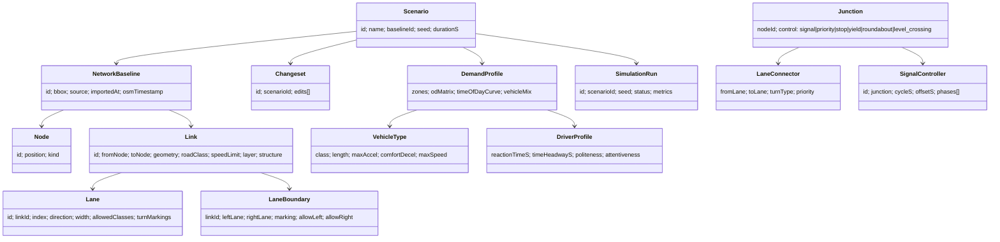
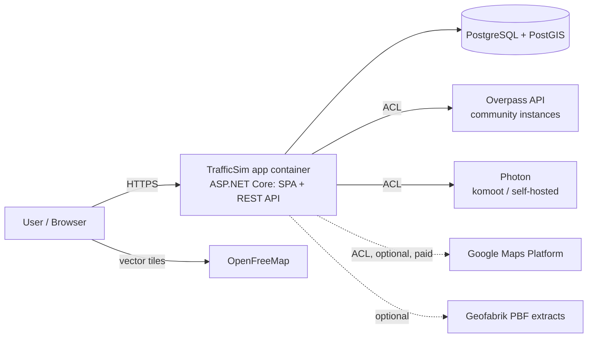
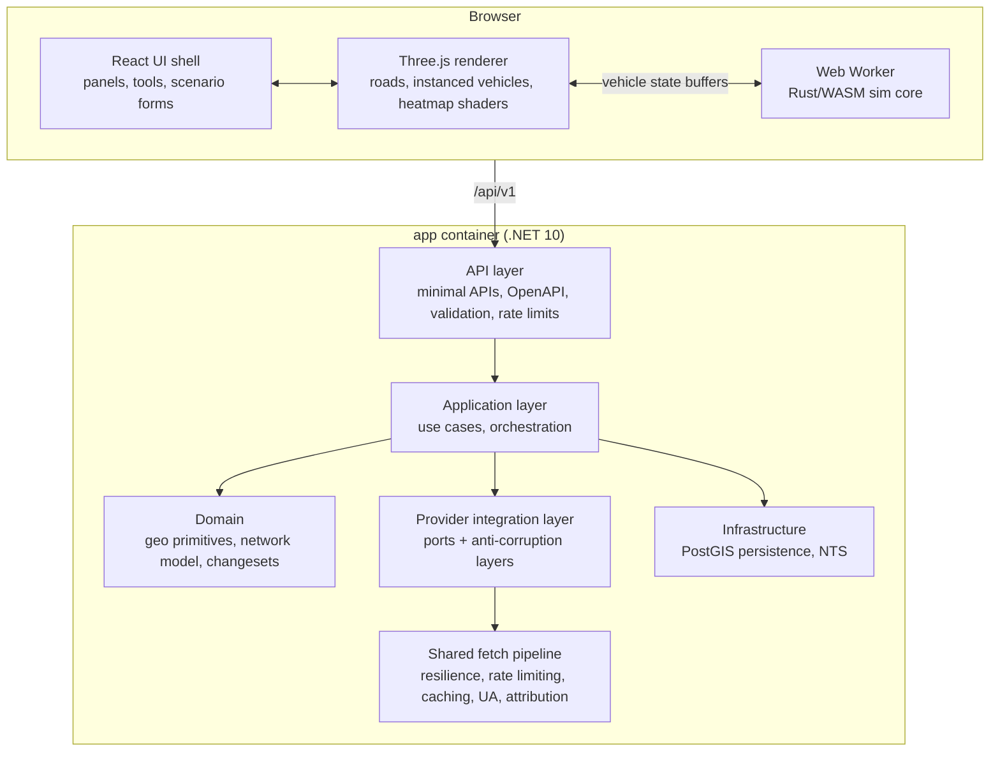
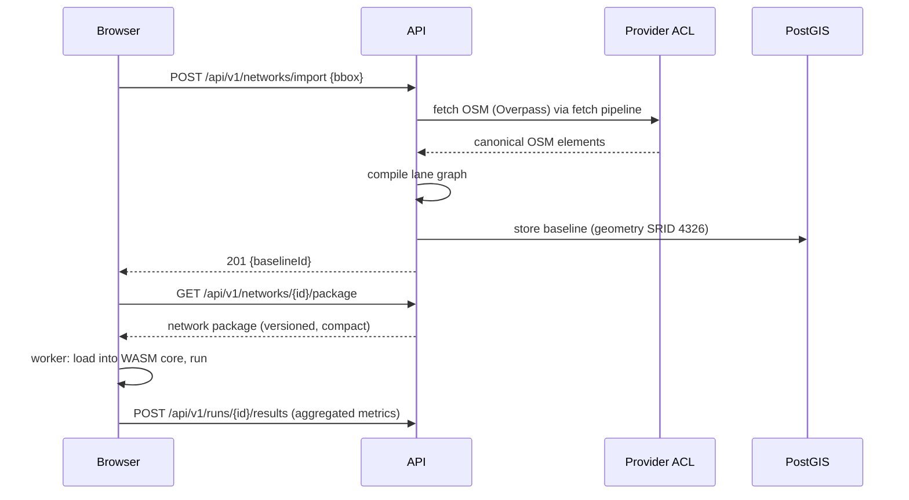

# TrafficSim — Concept

> Status: living document. Decisions referenced here are recorded as ADRs in [`docs/adr`](adr/).

## 1. Vision

TrafficSim is a browser-based, 3D **microscopic traffic simulator** built on real-world map data.
It loads the road network of any area from OpenStreetMap, lets users **modify it** (add lanes,
change turn lanes, retime traffic lights, add roads), simulates **every vehicle individually**,
and visualises the outcome as **heatmaps** of congestion, queues, speed and delay.

The interaction model is inspired by city-builder traffic tooling (e.g. the *Traffic Manager:
President Edition* mod for *Cities: Skylines*): lane-level control, junction-level rules,
immediate visual feedback. Unlike a game, TrafficSim works on **real geography** and produces
**reproducible, comparable** results.

### 1.1 Goals

| # | Goal |
|---|------|
| G1 | Load a real road network (city district, motorway section) from OSM in under a minute. |
| G2 | Lane-accurate network model: 0..n lanes per direction, turn lanes, lane connectors, speed limits, vehicle restrictions. |
| G3 | Agent-based simulation: every vehicle is simulated with its own type, driver profile, route and reaction time. |
| G4 | Traffic signals with phase plans; priority rules at unsignalised junctions. |
| G5 | Heatmaps for density, speed, queue length, delay, throughput — over time. |
| G6 | Editable network: changes layered over the OSM baseline, simulations re-run on edited networks, A/B comparison. |
| G7 | Runs in the browser (WebGL2), self-hostable with a single `docker compose up`. |
| G8 | Free data sources by default; paid providers pluggable later without touching the domain. |

### 1.2 Non-goals (for now)

- Pedestrians as agents walking a footway network (pedestrians are modelled as demand at crossings,
  [ADR-0020](adr/0020-pedestrian-crossings.md)), cyclists and public transport as simulated agents (backlog).
- Calibrated, legally binding traffic engineering studies (we aim for *plausible*, not certified).
- Multi-user real-time collaboration.
- Mobile devices as a primary target.
- Bulk-downloading or redistributing map data from providers whose terms forbid it (see §6).

## 2. Users and core use cases

| Persona | Use case |
|---------|----------|
| Curious citizen / student | "What happens on my commute if this road gets a second lane?" |
| Hobby planner / modder | Build a junction, tune signal phases, watch queues disappear. |
| Developer / researcher | Run deterministic scenarios, compare runs, extend models. |

**Primary flow**

1. Search a place (Photon geocoder) → pick an area (bounding box / polygon).
2. Backend fetches OSM data (Overpass or local extract) → **compiles a lane graph** → stores it in PostGIS.
3. Browser downloads the network package → 3D view of roads, lanes, junctions, signals.
4. User configures demand (commuter peak, uniform background, trucks share, OD zones).
5. Simulation runs in a Web Worker (Rust → WASM); vehicles rendered live in 3D.
6. Metrics aggregate into heatmaps (per lane cell × time bucket); time slider to replay.
7. User edits the network (e.g. adds a lane) → new scenario variant → re-run → compare A/B.

## 3. Domain model

Key concepts:

- **NetworkBaseline** — an immutable snapshot of compiled OSM data for an area. Never edited in place.
- **Changeset** — an ordered list of typed edits (`AddLane`, `RemoveLane`, `SetTurnLanes`,
  `SetSpeedLimit`, `AddLink`, `SetSignalPlan`, …) applied on top of a baseline ([ADR-0010](adr/0010-changesets-over-immutable-baseline.md)).
- **Lane graph** — the simulation's view of the network: lanes are edges, lane connectors at
  junctions link them. Compiled server-side from OSM tags ([ADR-0009](adr/0009-server-side-lane-graph-compilation.md)).
- **Vehicle** — instance of a `VehicleType` driven by a `DriverProfile`, following a route through the lane graph.

### 3.1 OSM → lane graph compilation (summary)

Roundabouts, bridges/tunnels and lane markings are specified in
[ADR-0016](adr/0016-roundabouts-grade-separation-lane-markings.md).

| OSM input | Interpretation |
|-----------|----------------|
| `highway=*` | road class → defaults for speed, lanes, priority |
| `lanes`, `lanes:forward`, `lanes:backward`, `oneway` | lane count per direction (0..n) |
| `turn:lanes[:forward\|:backward]` | turn markings → lane connector constraints |
| `maxspeed[:forward\|:backward]`, `maxspeed:lanes` | speed limits (country defaults when missing) |
| `highway=traffic_signals`, `traffic_signals:direction` | signal-controlled junctions |
| `highway=stop\|give_way` | junction control (yield / stop, with direction) |
| `junction=roundabout\|circular`, `highway=mini_roundabout` | roundabout ring (implicit one-way), entries yield to circulating traffic |
| `layer`, `bridge`, `tunnel`, `covered` | grade separation: vertical level and structure; no junction without a shared node |
| `change:lanes`, `change`, `overtaking`, `divider` | lane boundaries: dashed / solid / asymmetric markings, lane-change permissions |
| `railway=level_crossing` | level crossing control |
| `highway=crossing`, `crossing=*`, `crossing_ref`, `crossing:markings`, `footway=crossing` | pedestrian crossings (zebra, signal, uncontrolled, unmarked) plus implicit crosswalks at signalised junctions ([ADR-0020](adr/0020-pedestrian-crossings.md)) |
| `access`, `hgv`, `bus:lanes`, `psv` | vehicle class restrictions |
| `destination:lanes`, `placement`, `width` | rendering & lane change hints (later) |

Missing data is filled from per-country, per-road-class defaults and flagged so the UI can show
"assumed" values.

## 4. Simulation model

Details: [ADR-0007](adr/0007-microscopic-traffic-model.md).

- **Time stepping:** fixed step (default `Δt = 0.1 s`), deterministic, seeded PRNG (PCG32).
  Same inputs + seed ⇒ bit-identical outputs; this makes regression tests possible.
- **Car following:** Intelligent Driver Model (IDM) per vehicle with parameters from vehicle
  type × driver profile (`v0, T, a, b, s0, δ`).
- **Reaction time:** drivers perceive the leader state with a per-driver delay (ring buffer of
  past states, extrapolated with the old speed as in the Human Driver Model); inattentive drivers
  additionally get stochastic perception lapses. An emergency reflex on the true state keeps the
  model collision-free.
- **Lane changing:** MOBIL (politeness factor, safety criterion, keep-right bias for motorways);
  mandatory lane changes for routing (target lane before junction) with urgency ramp, strategic
  lane choice two links ahead (weaving). Lane boundaries (solid lines) restrict which changes are
  allowed. At on-ramps and lane drops, drivers next to the ending lane let mergers in (zipper)
  and mergers wait at the end of the acceleration lane for a gap.
- **Junctions:** lane connectors with conflict zones (same level only — bridges and tunnels never
  conflict); gap acceptance for priority / yield / stop / roundabout entries;
  signals as phase plans (fixed-time by default, vehicle-actuated per controller: detectors,
  min/max green, gap-out).
- **Routing:** shortest path on the link graph; familiar drivers (commuters) route on experienced,
  exponentially smoothed link travel times and re-plan en route periodically.
- **Demand:** boundary entries default to a road-class profile (volume per lane × lanes, 24 h
  curve), OD matrices between zones, residential trip generation inside the network
  (residential / living-street / service links, commuter curves), time-of-day curves, vehicle
  and driver mix per OD pair and time of day. The demand configuration shape is documented in
  `sim-core/README.md` (the backend generates a default per imported network).
- **Pedestrians:** crossing demand, not agents ([ADR-0020](adr/0020-pedestrian-crossings.md)):
  Poisson arrivals per crossing, walking at 1.3 m/s in groups; vehicles yield at zebra crossings,
  pedestrians accept gaps at uncontrolled crossings, request a pedestrian phase at push-button
  signals and conflict with turning vehicles during the parallel green at signalised junctions.
- **Vehicle diversity:** vehicle type catalogue as data (car, van, rigid and articulated truck,
  bus, motorcycle); driver profiles (*attentive*, *average*, *distracted*, *aggressive*,
  *commuter*) with truncated-normal distributions, not constants.

### 4.1 Metrics and heatmaps

Each lane is split into cells (default 10 m). Per cell and time bucket (default 30 s) the core
accumulates: occupancy/density, mean speed, speed ratio (`v / v_limit`), stops, queue presence,
throughput at cell boundaries, delay vs. free-flow. Buckets are exchanged in the compact binary
format `lane-cells-v1` (header, lane index table, Float32/Uint16 arrays; specified in
`sim-core/README.md`), which the frontend renders and the backend stores opaque. Junction
metrics: queue length per approach, wait time and delay per turn, HCM level of service. Run
summaries carry network KPIs and per-link metrics (mean speed, flow, density, delay, maximum
queue); tailbacks and stop-and-go waves are detected and reported as events.

Heatmaps are rendered as coloured lane ribbons (lane-accurate) and as a smoothed screen-space
density layer (overview). Phenomena we expect to reproduce and test against:

- stop-and-go waves / phantom jams on a ring road (Sugiyama experiment),
- tailbacks (*Rückstau*) behind a red light and spill-back into upstream junctions,
- platoons (*Kolonnenverkehr*) released by signals, green-wave effects,
- capacity drop at lane drops and merges, truck-induced moving bottlenecks.

## 5. Architecture

### 5.1 Context

### 5.2 Containers and layers

- **One HTTP port.** The app container serves the SPA, the WASM bundle and `/api/v1/*`
  ([ADR-0012](adr/0012-docker-compose-deployment.md)).
- **Modular monolith** backend with strict layer dependencies ([ADR-0002](adr/0002-dotnet-modular-monolith-backend.md)).
- **Provider integration layer** ([ADR-0004](adr/0004-provider-ports-and-anti-corruption-layers.md)):
  every external service sits behind a *port* (`IGeocodingProvider`, `IRoadNetworkSource`,
  `IBasemapProvider`, later `IElevationProvider`). Each adapter is an **anti-corruption layer**
  that translates provider DTOs into canonical domain types. All adapters share one **fetch
  pipeline** (typed `HttpClient`, retries with jitter, circuit breaker, per-provider rate limiter,
  response cache, User-Agent / contact header, attribution metadata).
- **Provider registry** with capabilities, priority and fallback chain, e.g. geocoding:
  `photon (community)` → `photon (self-hosted)` → `nominatim` → `google (disabled)`.
- **Simulation runs client-side** ([ADR-0006](adr/0006-rust-wasm-simulation-core.md)); the
  backend stores scenarios, networks and run results. A headless server-side runner (same
  Rust core, native) is a later option for batch runs.

### 5.3 Data flow: import → simulate → heatmap

## 6. External data sources and usage policies

Free by default; every provider is configurable and can be disabled ([ADR-0005](adr/0005-osm-authoritative-road-network.md)).

| Provider | Purpose | Policy notes we must honour |
|----------|---------|------------------------------|
| OpenStreetMap data (ODbL) | road network | Attribution "© OpenStreetMap contributors"; derived databases share-alike. |
| Overpass API (overpass-api.de, other community instances) | area extracts | Fair use: small bboxes, rate limiting, caching, identify via User-Agent. Large areas → Geofabrik extracts. |
| Photon (photon.komoot.io) | geocoding / search | Fair use, no bulk geocoding; self-hosted Photon container as fallback. |
| Nominatim (nominatim.openstreetmap.org) | reverse geocoding fallback | Max 1 req/s, valid User-Agent, caching required. |
| OpenFreeMap | vector tiles for basemap ground | Free, no key; attribution. |
| tile.openstreetmap.org | — | **Not used as default** (tile usage policy forbids heavy app usage). |
| Google Maps Platform | optional geocoding/basemap | Paid, API key; **ToS forbid extracting road geometry for our own model** → never a road-network source. Adapter scaffolded, disabled. |

## 7. Quality attributes

| Attribute | Target |
|-----------|--------|
| Simulation performance | 10 000 vehicles at ≥ 10× real time on a mid-range desktop (single worker). |
| Rendering | 60 fps with 10 000 instanced vehicles at medium zoom (WebGL2). |
| Determinism | Bit-identical metrics for identical scenario + seed (same build). |
| Import | District-sized area (~4 km²) imported and compiled in < 60 s. |
| Testability | Domain, compiler and sim core developed test-first; see [ADR-0013](adr/0013-testing-strategy.md). |
| Operability | `docker compose up` on a 4 CPU / 8 GB host; health and readiness endpoints. |

## 8. Phases

The phase plan lives in [`roadmap.md`](roadmap.md) and maps 1:1 to GitHub milestones.
